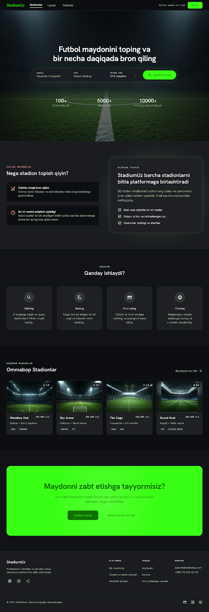
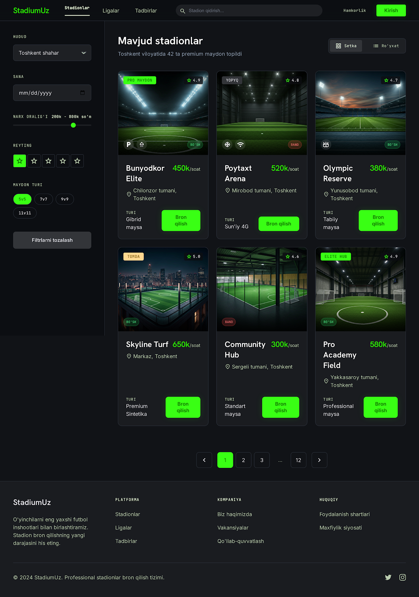
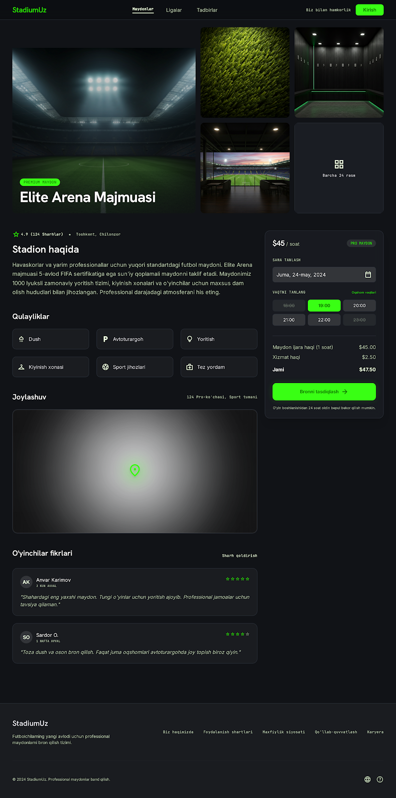
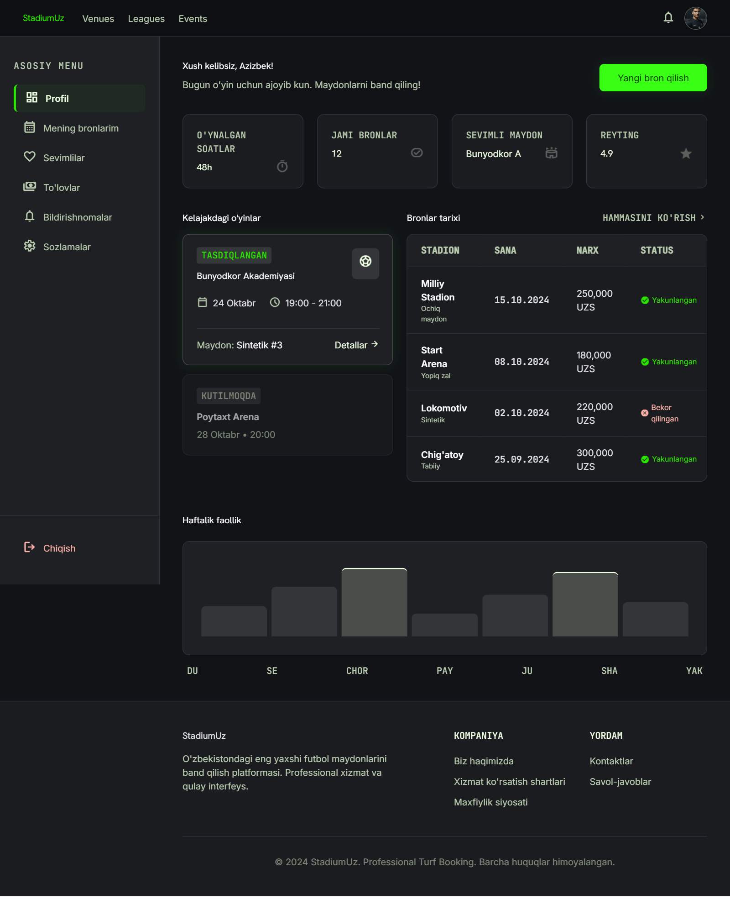
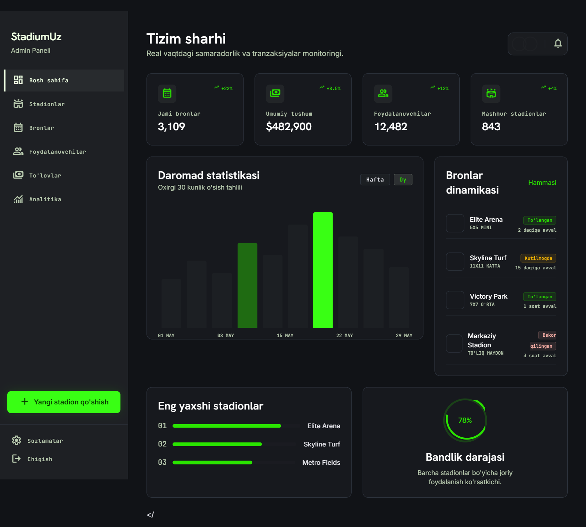
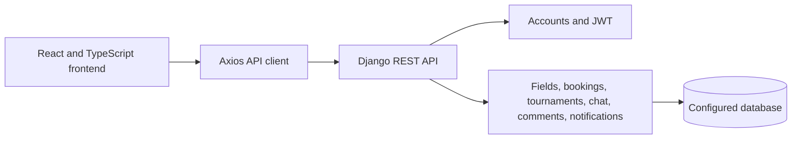

# StadiumUz — Stadium Discovery and Booking

     

## Overview

StadiumUz is a full-stack application for discovering football facilities and managing stadium bookings. Its Django REST API supports authentication, field discovery, booking, tournaments, notifications, comments, chat, and administrative operations; the frontend is a React and TypeScript application.

## Features

- Account registration and JWT-based authentication.
- Stadium and field discovery, details, and schedule/slot workflows.
- Booking creation and management.
- Tournament, comment/review, notification, and chat modules.
- Administrative management endpoints and frontend screens.
- OpenAPI schema and Swagger UI.

The repository does not demonstrate a live payment gateway. Do not describe local payment choices or booking records as completed online payment processing.

## Screenshots

Screens tracked in the repository:

| View | Preview |
|---|---|
| Home |  |
| Stadium search |  |
| Stadium details |  |
| User dashboard |  |
| Admin dashboard |  |

## Technology stack

| Layer | Technology |
|---|---|
| Backend | Python, Django, Django REST Framework, SimpleJWT, drf-spectacular |
| Frontend | React 18, TypeScript, Vite, React Router, Axios |
| Data | PostgreSQL configuration; migrations and Django ORM |
| Operations | Separate backend and frontend projects; no Railway/Vercel deployment descriptor is tracked |

## Architecture



## Repository layout

```text
backend/      Django project, apps, migrations, and API settings
frontend/     React/Vite source and design/export assets
```

## Installation

### Backend

```bash
cd backend
python -m venv .venv
source .venv/bin/activate
pip install -r requirements.txt
cp .env.example .env
python manage.py migrate
python manage.py runserver
```

### Frontend

```bash
cd frontend
npm ci
npm run dev
```

Configure the API base URL expected by the frontend, and ensure the backend's CORS settings allow the local frontend origin.

## Environment variables

The backend `.env.example` defines the available variables. Set real values locally or in your host's secret manager.

| Variable | Purpose |
|---|---|
| `SECRET_KEY`, `DEBUG`, `ALLOWED_HOSTS` | Django runtime security |
| `DATABASE_URL` | Database connection |
| `TELEGRAM_BOT_TOKEN`, `TELEGRAM_CHANNEL_ID` | Optional Telegram integration |
| Access/refresh token lifetime variables | JWT configuration |
| Frontend API URL | Backend origin for browser requests |

## API documentation

Start the backend and open **`/api/docs/`** for Swagger UI or **`/api/schema/`** for the generated schema. Routes are grouped under `/api/auth/`, `/api/field/`, `/api/bookings/`, `/api/tournaments/`, `/api/notifications/`, `/api/comments/`, `/api/chat/`, and `/api/admin/`.

## Database structure

The backend contains account, field, booking, tournament, notification, comment, chat, and core/admin domains, each with Django models and migrations. Review the source models for the exact relationships and constraints.

## Usage

1. Start Django and the Vite frontend.
2. Create an account and browse stadium/field listings.
3. Select a field and follow its availability and booking flow.
4. Use account, comments/chat, and tournament screens where the related API data is configured.

## Deployment

No Railway or Vercel deployment file is present in the repository. A deployment needs a Django-capable service, a production database, static/media handling, and a static frontend host. Build the frontend with `npm run build` and configure its API origin; deploy Django with production settings, an application server, secure hosts/CORS, and persistent media storage. Deployment has not been performed or verified.

## Security notes

- Use a unique secret, `DEBUG=False`, exact allowed hosts, and restricted CORS in production.
- Review the frontend's browser token storage and use secure cookie storage where appropriate.
- Booking data and user profiles should be access-controlled.
- Payment integrations are not verified as real payment processing; avoid implying otherwise.

## Tests

Several backend test modules are tracked. Configure the database and environment, then run the project's Django test suite. No test execution or passing result is claimed here.

## Future improvements

- Add CI for backend and frontend checks.
- Document exact deployment configuration and health checks.
- Add accessible alt text/context to each screenshot and provide sanitized demo data.
- Review JWT storage and document booking/payment boundaries.
